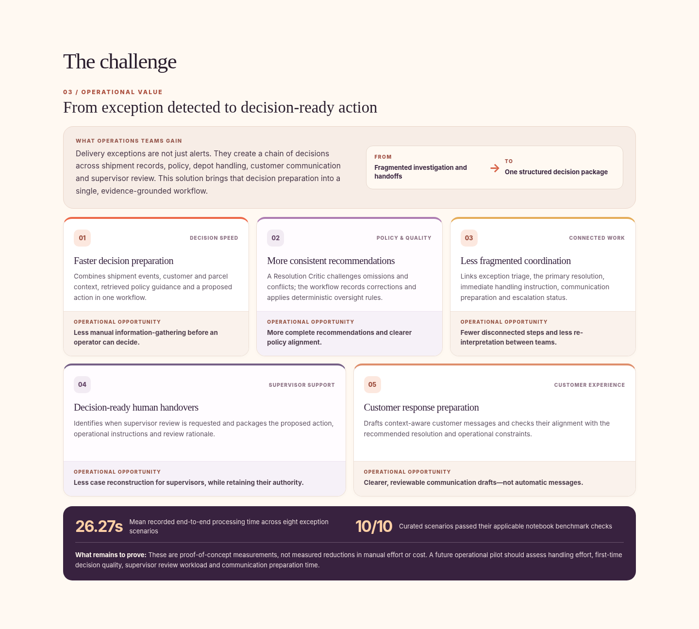
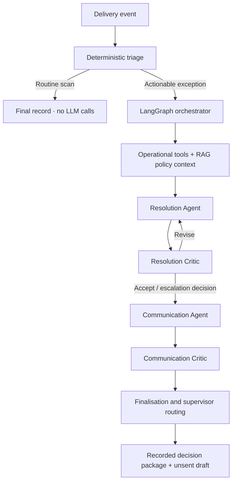

# Exception / Control
### Multi-Agent AI for Last-Mile Delivery Exception Management

A read-only, interactive Streamlit demonstration of an implemented and evaluated **multi-agent delivery-exception workflow**. It shows how specialised AI agents can turn fragmented delivery events into **reviewed, decision-ready action packages**, with separate customer communication and human-escalation decisions.

> **Public demonstration:** This website replays recorded LangSmith executions from an earlier notebook run. It does **not** run live models, contact customers, modify shipments or connect to a logistics production system.



## The operational challenge

When a delivery fails, operations teams must distinguish routine scans from genuine exceptions, reconstruct shipment and customer context, consult policy, decide on a resolution, specify immediate parcel handling, prepare communications and recognise when a supervisor must intervene. These linked decisions can span several systems and teams.

**The solution's proposition:** move from scattered exception signals to a structured, explainable recommendation and a decision-ready handover. It supports human decision-making; it does not claim to replace operational authorisation.

## Where the value lies

| Operational capability | Potential benefit to validate in a pilot |
| --- | --- |
| **Faster decision preparation** — consolidate operational context and proposed action | Less manual information gathering |
| **More consistent recommendations** — policy-grounded reasoning with Critic validation | More complete and repeatable decisions |
| **Coordinated exception handling** — link triage, resolution, handling and communication | Fewer fragmented handoffs |
| **Decision-ready supervisor escalation** — provide an evidence-backed recommendation | Less case reconstruction for reviewers |
| **Customer-response preparation** — produce reviewed, context-aware drafts | Faster, clearer communication preparation |

These are **potential operational outcomes**, not measured savings. No manual-vs-AI efficiency study or production pilot is claimed.

## How the agentic workflow works



The original project combines deterministic preprocessing, operational lookups, policy retrieval, specialist Resolution and Communication Agents, independent Critic assessments, bounded revision loops and escalation safeguards. **Critic acceptance is not human approval.** The public app exposes the recorded outcomes without executing the original workflow.

## What visitors can explore

The app preserves six workspaces:

1. **The challenge:** real operational friction, five value propositions and benchmark context.
2. **Architecture:** the implemented orchestration, agents, deterministic fast path, tools and validation loops.
3. **Case stories:** guided explanations of ten recorded delivery events and a captioned example walkthrough.
4. **Agent flow:** animated handoffs and return loops, with captured Critic objections, revised proposals and stage durations.
5. **Evidence room:** recorded proposals, Critic reviews, unsent customer drafts and oversight decisions.
6. **Results:** benchmark checks, model-assessed reasoning coherence, measured trace durations and known limitations.

**Suggested first demonstration:** Compare **SHP-006** (Critic feedback improves an operational handling instruction without a supervisor escalation) with **SHP-004** (two Critic revisions, an unresolved policy/customer-choice concern and escalation). See **SHP-003** for a correctly resolved reschedule without escalation.

## Recorded proof-of-concept evidence

| Measure | Captured result |
| --- | ---: |
| Curated scenarios | 10 |
| Genuine exception scenarios | 8 |
| Mean end-to-end time across exceptions | **26.27 seconds** |
| Mean time across all ten scenarios | **21.02 seconds** |
| LangSmith spans | **446** |
| Applicable notebook benchmark checks | **10/10 scenarios passed** |
| Model-as-Judge coherence | Eight scores of 5/5, one 3/5, one 2/5 |

Two routine events bypassed AI processing. Six cases requested supervisor escalation, while two genuine exceptions did not. These results come from a small, deliberately selected benchmark and **do not establish production reliability, operational cost savings, or an improvement over manual handling**. The app also acknowledges two recovered internal validation-error spans in the SHP-004 trace; the completed case passed its notebook assessment.

## Run locally or deploy to Streamlit Cloud

**Requirements:** Python 3.10+ and the packages in `requirements.txt`.

```bash
python -m pip install -r requirements.txt
streamlit run app.py
```

For **Streamlit Community Cloud**, select this repository, the `main` branch, and `app.py` as the entry point. No model provider key, backend service or REST API is required for this recorded-replay application.

Run the offline checks with:

```bash
python -m pip install pytest
python -m pytest -q
```

### Repository layout

```text
.
├── app.py                  # Streamlit entry point
├── requirements.txt        # Minimal runtime dependencies
├── src/                    # Replay, storyline, decision and evidence helpers
├── data/                   # Anonymised, allowlisted recorded scenarios
├── assets/                 # Stylesheet and recorded walkthrough video
├── docs/                   # Publication checklist and screenshot
├── scripts/                # Optional offline authoring tools; not run by the app
├── tests/                  # Offline consistency and data-integrity checks
└── .streamlit/config.toml  # Streamlit visual configuration
```

### Public-data and operational boundaries

- The included scenario JSON was allowlisted and automatically redacted. **Human privacy and internal-policy review is required before public publication.** See [the publication checklist](docs/PUBLICATION_CHECKLIST.md).
- The repository must **never** include private LangSmith trace archives, credentials, customer databases, original notebooks or restricted policy/playbook documents.
- The replay does not perform live inference, approve operational decisions, send customer messages, update deliveries or notify a supervisor.
- Captured timings reflect the original execution; the animation intentionally plays more slowly so humans can read it.

---

## Version and release history

**Current application:** `v2.4.0` · **Trace batch:** 17 October 2026.

| Release | Summary |
| --- | --- |
| **v2.4.0** | Added five-card Operational Value presentation; all recorded evidence and decisions unchanged from v2.3.4. |
| **v2.3.4** | Refreshed the ten scenarios, validated notebook assessment results, and adjusted human-readable playback. |
| **v2.3.x** | Introduced detailed LangSmith Critic feedback, Agent Flow, clearer escalation distinctions and footer versioning. |
| **v2.0–v2.2** | Established distinct visual presentation, guided stories, architecture and trace-informed replay. |

The reorganised GitHub folder layout changes **packaging only**, not the application's version, logic or recorded outcomes.
